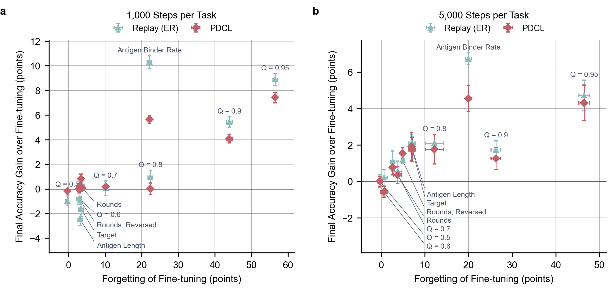
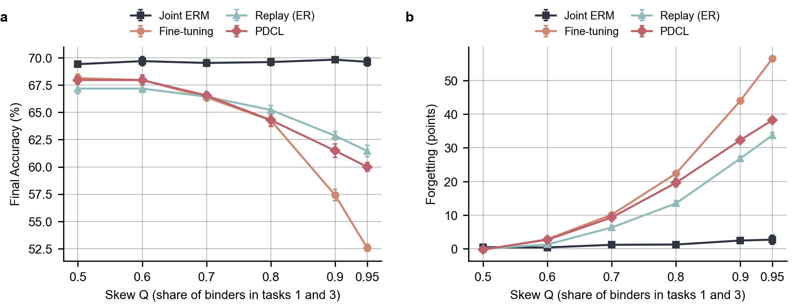
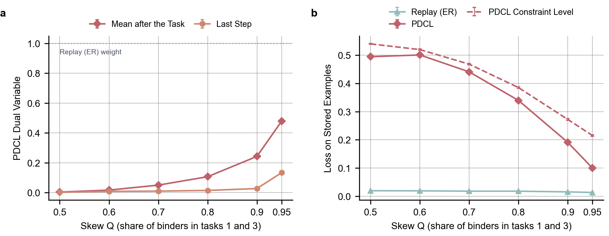
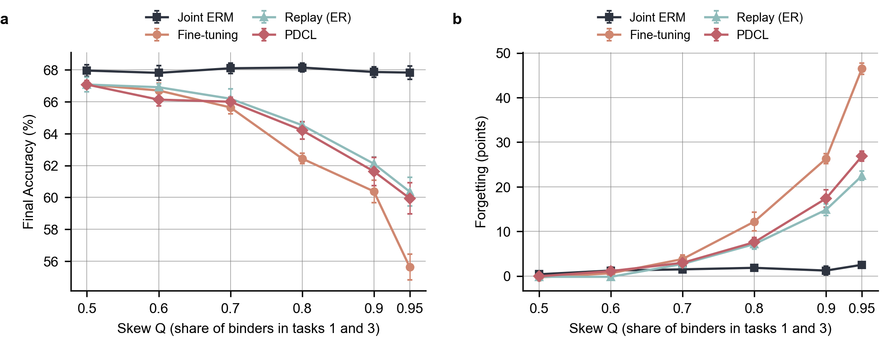

# E1. Retention dial

Branch `claude/pdcl-e1-retention-dial-6f00e4`, cut from `pdcl-scope`. Design: `findings.md`
section 0, followed without change. All numbers are validation accuracy in percent, mean ±
standard error over seeds; differences are paired by seed; **bold** marks a difference beyond
two standard errors, the pre-registered rule for "real". Everything else is a null.

- Runs: `results/e1_sweeps.json` (1,000 steps per task, seeds 0–9, 440 runs) and
  `results/e1_long_sweeps.json` (5,000 steps per task, seeds 0–4, 220 runs), code hash
  `6766f6a0952f`. Per-run tables: `results/e1_runs.csv`, `results/e1_long_runs.csv`.
- The long sweep was run as several processes over disjoint streams of the same spec
  (`rounds`, `rounds:3210`, `aglen` in one; `target`, `agrate`; `skew:0.5–0.7`; `skew:0.8–0.95`),
  on GPUs 6 and 0; design and seeds unchanged.
- `python -m domainbed.scripts.e1_retention` rebuilds the tables (`results/e1_tables.md`,
  which also has the full tables of the long runs) and the figures.

## Summary

1. **Where retention is cheap, PDCL is fine-tuning.** At 1,000 steps per task, on the design
   rounds in either order, on the two natural antigen-disjoint streams and on skew up to
   Q = 0.8, PDCL − fine-tuning is within ±0.25 points and null, with two exceptions of small
   size: `target` (+0.84 ± 0.37) and the random split `skew:0.5` (−0.17 ± 0.08). Its dual
   variables there average 0.002 to 0.11, against ER's fixed weight of 1.
2. **Being fine-tuning is the better choice on those streams.** ER at weight 1 is *below*
   fine-tuning on `aglen` (−2.48 ± 0.49), `target` (−1.62 ± 0.60), `rounds:3210`
   (−0.94 ± 0.32) and `skew:0.5` (−0.96 ± 0.41). PDCL beats ER there by not replaying, not by
   retaining more than fine-tuning does.
3. **Where retention is expensive, PDCL gains over fine-tuning but less than ER.** `skew:0.9`:
   PDCL +4.07 ± 0.34, ER +5.44 ± 0.42. `skew:0.95`: +7.43 ± 0.43 against +8.89 ± 0.47.
   `agrate`: +5.65 ± 0.33 against +10.31 ± 0.50. PDCL recovers 75%, 84% and 55% of ER's gain
   and loses to ER by 1.37 ± 0.39, 1.46 ± 0.31 and 4.66 ± 0.48 points.
4. **The switch is late and depends on the kind of shift.** At `skew:0.8` fine-tuning forgets
   22.4 points and PDCL's gain is +0.02 ± 0.45; at `agrate` fine-tuning forgets 22.1 points
   and PDCL gains 5.65. On `agrate` the dual variables stay at 0.013, as low as on `rounds`:
   the constraint on the stored examples' loss is met while validation accuracy on the first
   task falls by 30 points. The dual variable does not read out that cost.
5. **With five times the training (5,000 steps per task) the picture shifts towards replay.**
   Fine-tuning forgets more on the natural streams (7.0 on `aglen`, 7.1 on `target`), ER and
   PDCL both gain about 2 points over it there, and PDCL − ER is null on every stream except
   `agrate` (−2.18 ± 0.82) and `skew:0.6` (−0.78 ± 0.29). PDCL beats ER nowhere at this length.
6. Joint training stays ahead of everything: joint − fine-tuning is +1.3 to +17.1 at 1,000
   steps per task and real on all 11 streams; at `skew:0.95` the best sequential method (ER)
   is still 8.2 points below joint.

## Predictions

| | Prediction | 1,000 steps per task (main) | 5,000 steps per task |
|---|---|---|---|
| (a) | PDCL − fine-tuning is zero on `skew:0.5` and `rounds` | `rounds` +0.08 ± 0.24: **held**. `skew:0.5` −0.17 ± 0.08: **failed** by the two-standard-error rule; the size is 0.17 points and the sign is against PDCL | `rounds` +0.76 ± 0.40, `skew:0.5` +0.00 ± 0.26: held (both null) |
| (b) | PDCL's gain over fine-tuning grows with fine-tuning's forgetting on the stream | **Held as a rank trend** (Spearman 0.72, interval 0.40 to 0.92, 11 streams), but it is a threshold and not a dial: null up to 22 points of forgetting on the skew streams, then +4.1 and +7.4; and the same forgetting gives +0.02 (`skew:0.8`) or +5.65 (`agrate`) | Held (Spearman 0.80, interval 0.69 to 0.90); the gain is real and positive on 7 streams, real and negative on `skew:0.6` (−0.57 ± 0.28) |
| (c) | PDCL is never more than 0.5 points below the better of fine-tuning and ER | **Failed** on 4 of 11 streams: `agrate` −4.66 ± 0.48, `skew:0.95` −1.46 ± 0.31, `skew:0.9` −1.37 ± 0.39, `skew:0.8` −0.93 ± 0.47 | **Failed** on 2 of 11: `agrate` −2.18 ± 0.82, `skew:0.6` −0.78 ± 0.29. The other nine means are within 0.5, with standard errors of 0.3 to 0.6 |

The statistic for (b) (Spearman correlation and slope of the 11 stream means, interval from
resampling seeds) was fixed in the analysis script before the runs finished; the design names
no statistic, so read it as my operationalization.

**Open question 1: do the natural antigen-disjoint streams forget enough for memory to
matter?** At 1,000 steps per task, no. Fine-tuning forgets 3.2 ± 0.5 points on `aglen` and
3.4 ± 0.6 on `target`, the same as on the design rounds (3.8 ± 0.7), and joint − fine-tuning is
smaller there (+1.8, +2.0) than on the rounds (+3.6). Replay at weight 1 costs accuracy; PDCL
is null on `aglen` (+0.24 ± 0.15) and marginal on `target` (+0.84 ± 0.37, 2.3 standard errors,
one of 11 streams tested). At 5,000 steps per task, yes, modestly: fine-tuning forgets 7.0 and
7.1 points, ER gains +2.09 ± 0.47 and +2.10 ± 0.37, PDCL +1.91 ± 0.75 and +1.74 ± 0.65, about
40% of the gap to joint training (4.4 and 4.9), and PDCL and ER are indistinguishable.

**Open question 2: does PDCL beat ER anywhere, or lose to it?** At 1,000 steps per task PDCL
beats ER on `aglen` (+2.72 ± 0.45), `target` (+2.46 ± 0.36), `rounds:3210` (+0.93 ± 0.38) and
`skew:0.5` (+0.79 ± 0.37): exactly the streams where ER is below fine-tuning, and PDCL is
within 0.25 points of fine-tuning on three of them. PDCL loses to ER on `agrate` (−4.66 ± 0.48), `skew:0.95` (−1.46 ± 0.31)
and `skew:0.9` (−1.37 ± 0.39), where forgetting is large. At 5,000 steps per task PDCL beats
ER nowhere and loses on `agrate` and `skew:0.6`. `target` at 1,000 steps is the only stream, at either length, where PDCL is
above both fine-tuning (+0.84 ± 0.37) and ER by more than two standard errors.

## 1,000 steps per task, ten seeds

Gain in final accuracy over fine-tuning against how much fine-tuning forgets on the stream;
one point per stream, bars are one standard error. `paper/figures/fig_e1_gain.{pdf,png}`.

### Methods

| Stream | Method | Final accuracy | Forgetting | Learned accuracy |
|---|---|---|---|---|
| Rounds | Joint ERM | 70.1 ± 0.3 | 0.4 ± 0.3 | 69.4 ± 0.3 |
| Rounds | Fine-tuning | 66.5 ± 0.6 | 3.8 ± 0.7 | 69.2 ± 0.3 |
| Rounds | Replay (ER) | 66.8 ± 0.4 | 2.3 ± 0.4 | 68.0 ± 0.2 |
| Rounds | PDCL | 66.6 ± 0.5 | 3.6 ± 0.5 | 69.1 ± 0.3 |
| Rounds, Reversed | Joint ERM | 70.0 ± 0.4 | 1.1 ± 0.3 | 70.4 ± 0.3 |
| Rounds, Reversed | Fine-tuning | 67.4 ± 0.3 | 3.2 ± 0.3 | 69.5 ± 0.2 |
| Rounds, Reversed | Replay (ER) | 66.4 ± 0.2 | 3.5 ± 0.4 | 68.9 ± 0.2 |
| Rounds, Reversed | PDCL | 67.4 ± 0.3 | 3.0 ± 0.3 | 69.3 ± 0.2 |
| Antigen Length | Joint ERM | 69.8 ± 0.3 | 0.0 ± 0.3 | 69.4 ± 0.3 |
| Antigen Length | Fine-tuning | 68.0 ± 0.4 | 3.2 ± 0.5 | 70.2 ± 0.3 |
| Antigen Length | Replay (ER) | 65.5 ± 0.3 | 4.7 ± 0.3 | 68.9 ± 0.3 |
| Antigen Length | PDCL | 68.2 ± 0.4 | 2.9 ± 0.5 | 70.2 ± 0.3 |
| Target | Joint ERM | 69.5 ± 0.3 | 0.4 ± 0.3 | 69.4 ± 0.4 |
| Target | Fine-tuning | 67.5 ± 0.6 | 3.4 ± 0.6 | 69.8 ± 0.3 |
| Target | Replay (ER) | 65.9 ± 0.4 | 4.4 ± 0.4 | 69.0 ± 0.4 |
| Target | PDCL | 68.3 ± 0.5 | 2.2 ± 0.3 | 69.8 ± 0.4 |
| Antigen Binder Rate | Joint ERM | 69.9 ± 0.2 | 0.3 ± 0.4 | 69.5 ± 0.3 |
| Antigen Binder Rate | Fine-tuning | 54.1 ± 0.2 | 22.1 ± 0.6 | 70.7 ± 0.3 |
| Antigen Binder Rate | Replay (ER) | 64.4 ± 0.4 | 6.9 ± 0.6 | 69.4 ± 0.3 |
| Antigen Binder Rate | PDCL | 59.7 ± 0.4 | 14.6 ± 0.8 | 70.6 ± 0.3 |
| Skew 0.5 | Joint ERM | 69.4 ± 0.3 | 0.5 ± 0.2 | 69.2 ± 0.3 |
| Skew 0.5 | Fine-tuning | 68.1 ± 0.4 | -0.3 ± 0.4 | 67.0 ± 0.4 |
| Skew 0.5 | Replay (ER) | 67.2 ± 0.5 | 0.1 ± 0.3 | 66.5 ± 0.4 |
| Skew 0.5 | PDCL | 68.0 ± 0.3 | -0.2 ± 0.4 | 66.9 ± 0.4 |
| Skew 0.6 | Joint ERM | 69.7 ± 0.4 | 0.4 ± 0.3 | 69.2 ± 0.3 |
| Skew 0.6 | Fine-tuning | 68.0 ± 0.4 | 2.9 ± 0.6 | 69.5 ± 0.3 |
| Skew 0.6 | Replay (ER) | 67.2 ± 0.4 | 1.3 ± 0.5 | 67.9 ± 0.4 |
| Skew 0.6 | PDCL | 68.0 ± 0.5 | 2.7 ± 0.6 | 69.3 ± 0.3 |
| Skew 0.7 | Joint ERM | 69.5 ± 0.3 | 1.2 ± 0.6 | 69.4 ± 0.5 |
| Skew 0.7 | Fine-tuning | 66.4 ± 0.3 | 10.2 ± 0.6 | 73.9 ± 0.3 |
| Skew 0.7 | Replay (ER) | 66.4 ± 0.4 | 6.3 ± 0.6 | 71.2 ± 0.2 |
| Skew 0.7 | PDCL | 66.6 ± 0.3 | 9.3 ± 0.5 | 73.5 ± 0.3 |
| Skew 0.8 | Joint ERM | 69.6 ± 0.3 | 1.3 ± 0.4 | 69.8 ± 0.4 |
| Skew 0.8 | Fine-tuning | 64.3 ± 0.5 | 22.4 ± 0.6 | 80.9 ± 0.1 |
| Skew 0.8 | Replay (ER) | 65.2 ± 0.4 | 13.5 ± 0.8 | 75.4 ± 0.4 |
| Skew 0.8 | PDCL | 64.3 ± 0.6 | 19.6 ± 1.2 | 79.0 ± 0.4 |
| Skew 0.9 | Joint ERM | 69.8 ± 0.2 | 2.5 ± 0.9 | 69.7 ± 0.8 |
| Skew 0.9 | Fine-tuning | 57.4 ± 0.5 | 44.0 ± 0.8 | 90.4 ± 0.1 |
| Skew 0.9 | Replay (ER) | 62.9 ± 0.4 | 26.8 ± 0.6 | 83.0 ± 0.3 |
| Skew 0.9 | PDCL | 61.5 ± 0.6 | 32.3 ± 0.9 | 85.7 ± 0.3 |
| Skew 0.95 | Joint ERM | 69.6 ± 0.4 | 2.7 ± 1.3 | 69.8 ± 1.0 |
| Skew 0.95 | Fine-tuning | 52.6 ± 0.3 | 56.5 ± 0.6 | 95.0 ± 0.2 |
| Skew 0.95 | Replay (ER) | 61.5 ± 0.5 | 33.7 ± 0.9 | 86.8 ± 0.3 |
| Skew 0.95 | PDCL | 60.0 ± 0.4 | 38.2 ± 0.5 | 88.7 ± 0.3 |

Learned accuracy is the accuracy of each task at the end of its own phase. On the skewed
streams it rises with Q for the sequential methods because a task with a 90% binder rate is
easy to fit alone; the cost shows up as forgetting.

### Paired differences in final accuracy

| Stream | PDCL − FT | ER − FT | PDCL − ER | Joint − FT |
|---|---|---|---|---|
| Rounds | +0.08 ± 0.24 | +0.30 ± 0.35 | -0.22 ± 0.24 | **+3.56 ± 0.50** |
| Rounds, Reversed | -0.01 ± 0.17 | **-0.94 ± 0.32** | **+0.93 ± 0.38** | **+2.63 ± 0.52** |
| Antigen Length | +0.24 ± 0.15 | **-2.48 ± 0.49** | **+2.72 ± 0.45** | **+1.83 ± 0.49** |
| Target | **+0.84 ± 0.37** | **-1.62 ± 0.60** | **+2.46 ± 0.36** | **+2.03 ± 0.39** |
| Antigen Binder Rate | **+5.65 ± 0.33** | **+10.31 ± 0.50** | **-4.66 ± 0.48** | **+15.83 ± 0.42** |
| Skew 0.5 | **-0.17 ± 0.08** | **-0.96 ± 0.41** | **+0.79 ± 0.37** | **+1.28 ± 0.30** |
| Skew 0.6 | -0.01 ± 0.15 | -0.79 ± 0.46 | +0.78 ± 0.52 | **+1.73 ± 0.47** |
| Skew 0.7 | +0.17 ± 0.17 | +0.06 ± 0.58 | +0.11 ± 0.58 | **+3.15 ± 0.48** |
| Skew 0.8 | +0.02 ± 0.45 | +0.95 ± 0.55 | -0.93 ± 0.47 | **+5.34 ± 0.53** |
| Skew 0.9 | **+4.07 ± 0.34** | **+5.44 ± 0.42** | **-1.37 ± 0.39** | **+12.42 ± 0.44** |
| Skew 0.95 | **+7.43 ± 0.43** | **+8.89 ± 0.47** | **-1.46 ± 0.31** | **+17.07 ± 0.49** |

### Paired differences in forgetting

| Stream | PDCL − FT | ER − FT | PDCL − ER | Joint − FT |
|---|---|---|---|---|
| Rounds | -0.24 ± 0.33 | **-1.49 ± 0.61** | **+1.24 ± 0.51** | **-3.37 ± 0.70** |
| Rounds, Reversed | -0.16 ± 0.24 | +0.28 ± 0.36 | -0.44 ± 0.38 | **-2.07 ± 0.37** |
| Antigen Length | -0.28 ± 0.24 | **+1.48 ± 0.56** | **-1.76 ± 0.40** | **-3.13 ± 0.66** |
| Target | **-1.21 ± 0.53** | +0.94 ± 0.83 | **-2.15 ± 0.54** | **-3.08 ± 0.52** |
| Antigen Binder Rate | **-7.56 ± 0.40** | **-15.28 ± 0.71** | **+7.72 ± 0.75** | **-21.85 ± 0.56** |
| Skew 0.5 | +0.11 ± 0.12 | +0.37 ± 0.38 | -0.26 ± 0.37 | +0.80 ± 0.45 |
| Skew 0.6 | -0.16 ± 0.27 | **-1.55 ± 0.74** | +1.39 ± 0.81 | **-2.45 ± 0.70** |
| Skew 0.7 | **-0.83 ± 0.32** | **-3.81 ± 0.87** | **+2.98 ± 0.78** | **-8.94 ± 0.80** |
| Skew 0.8 | **-2.74 ± 1.05** | **-8.86 ± 1.02** | **+6.13 ± 0.70** | **-21.09 ± 0.78** |
| Skew 0.9 | **-11.69 ± 0.62** | **-17.15 ± 0.84** | **+5.46 ± 0.57** | **-41.49 ± 1.00** |
| Skew 0.95 | **-18.28 ± 0.80** | **-22.78 ± 0.93** | **+4.50 ± 0.73** | **-53.78 ± 1.05** |

PDCL reduces forgetting relative to fine-tuning from `skew:0.7` on (−0.83 ± 0.32) without a
gain in final accuracy until `skew:0.9`: what it saves on the earlier tasks it gives up in
learned accuracy.

### The dial

| Stream (by fine-tuning's forgetting) | Fine-tuning's forgetting | ER − FT | PDCL − FT |
|---|---|---|---|
| Skew 0.5 | -0.30 ± 0.42 | -0.96 ± 0.41 | -0.17 ± 0.08 |
| Skew 0.6 | 2.87 ± 0.59 | -0.79 ± 0.46 | -0.01 ± 0.15 |
| Antigen Length | 3.18 ± 0.55 | -2.48 ± 0.49 | +0.24 ± 0.15 |
| Rounds, Reversed | 3.21 ± 0.29 | -0.94 ± 0.32 | -0.01 ± 0.17 |
| Target | 3.44 ± 0.60 | -1.62 ± 0.60 | +0.84 ± 0.37 |
| Rounds | 3.80 ± 0.67 | +0.30 ± 0.35 | +0.08 ± 0.24 |
| Skew 0.7 | 10.16 ± 0.58 | +0.06 ± 0.58 | +0.17 ± 0.17 |
| Antigen Binder Rate | 22.15 ± 0.62 | +10.31 ± 0.50 | +5.65 ± 0.33 |
| Skew 0.8 | 22.38 ± 0.63 | +0.95 ± 0.55 | +0.02 ± 0.45 |
| Skew 0.9 | 43.97 ± 0.78 | +5.44 ± 0.42 | +4.07 ± 0.34 |
| Skew 0.95 | 56.51 ± 0.56 | +8.89 ± 0.47 | +7.43 ± 0.43 |

PDCL gain against fine-tuning's forgetting, 11 streams: Spearman rho 0.72 [0.40, 0.92], slope 0.12 [0.11, 0.13] points of accuracy per point of forgetting (95% interval, seeds resampled).

ER gain against fine-tuning's forgetting, 11 streams: Spearman rho 0.82 [0.68, 0.90], slope 0.19 [0.17, 0.20] points of accuracy per point of forgetting (95% interval, seeds resampled).

### PDCL against the better of fine-tuning and ER

| Stream | Better of FT and ER | PDCL − better | Within 0.5 points |
|---|---|---|---|
| Rounds | ER | -0.22 ± 0.24 | yes |
| Rounds, Reversed | FT | -0.01 ± 0.17 | yes |
| Antigen Length | FT | +0.24 ± 0.15 | yes |
| Target | FT | +0.84 ± 0.37 | yes |
| Antigen Binder Rate | ER | -4.66 ± 0.48 | **no** |
| Skew 0.5 | FT | -0.17 ± 0.08 | yes |
| Skew 0.6 | FT | -0.01 ± 0.15 | yes |
| Skew 0.7 | ER | +0.11 ± 0.58 | yes |
| Skew 0.8 | ER | -0.93 ± 0.47 | **no** |
| Skew 0.9 | ER | -1.37 ± 0.39 | **no** |
| Skew 0.95 | ER | -1.46 ± 0.31 | **no** |

### Skew

`paper/figures/fig_e1_skew.{pdf,png}`. Fine-tuning and PDCL coincide up to Q = 0.8; ER is
below both at Q ≤ 0.6 and above both from Q = 0.8.

## Mechanism: do the constraints bind?

`paper/figures/fig_e1_dual.{pdf,png}`. Averages over the three earlier tasks and the seeds;
"last step" quantities are from the last checkpoint (replay loss: mean over its last 250
steps).

| Stream | Dual, mean after the task | Dual, last step | Largest dual, last step | Duals above 0 at the end (%) | Constraint level | Replay loss, PDCL | Replay loss above level (%) | Replay loss, ER |
|---|---|---|---|---|---|---|---|---|
| Rounds | 0.015 ± 0.002 | 0.006 ± 0.001 | 0.03 | 63 | 0.500 ± 0.002 | 0.480 ± 0.004 | 17 | 0.018 ± 0.001 |
| Rounds, Reversed | 0.013 ± 0.002 | 0.002 ± 0.001 | 0.02 | 63 | 0.519 ± 0.002 | 0.492 ± 0.006 | 10 | 0.009 ± 0.000 |
| Antigen Length | 0.002 ± 0.001 | 0.001 ± 0.000 | 0.01 | 50 | 0.537 ± 0.002 | 0.503 ± 0.005 | 3 | 0.014 ± 0.001 |
| Target | 0.003 ± 0.001 | 0.002 ± 0.001 | 0.01 | 53 | 0.517 ± 0.001 | 0.490 ± 0.003 | 3 | 0.011 ± 0.001 |
| Antigen Binder Rate | 0.013 ± 0.001 | 0.003 ± 0.001 | 0.02 | 67 | 0.592 ± 0.002 | 0.568 ± 0.003 | 0 | 0.011 ± 0.000 |
| Skew 0.5 | 0.004 ± 0.001 | 0.002 ± 0.001 | 0.03 | 53 | 0.540 ± 0.002 | 0.495 ± 0.008 | 7 | 0.020 ± 0.001 |
| Skew 0.6 | 0.017 ± 0.002 | 0.009 ± 0.002 | 0.04 | 80 | 0.520 ± 0.002 | 0.501 ± 0.006 | 23 | 0.019 ± 0.001 |
| Skew 0.7 | 0.051 ± 0.001 | 0.011 ± 0.002 | 0.04 | 63 | 0.468 ± 0.002 | 0.441 ± 0.005 | 20 | 0.018 ± 0.001 |
| Skew 0.8 | 0.107 ± 0.002 | 0.015 ± 0.002 | 0.05 | 73 | 0.385 ± 0.002 | 0.340 ± 0.004 | 13 | 0.018 ± 0.000 |
| Skew 0.9 | 0.243 ± 0.004 | 0.028 ± 0.004 | 0.13 | 70 | 0.272 ± 0.003 | 0.191 ± 0.006 | 10 | 0.015 ± 0.001 |
| Skew 0.95 | 0.479 ± 0.012 | 0.134 ± 0.012 | 0.51 | 67 | 0.215 ± 0.003 | 0.100 ± 0.008 | 3 | 0.013 ± 0.000 |

- **ER drives the loss on its 200 stored examples to 0.01–0.02**, whatever the stream. PDCL's
  constraint level is 1.1 × the training loss at the end of the task (0.2 to 0.6 at this
  length), and PDCL holds the stored-example loss just under it, 5 to 50 times above ER's.
- **The constraints are satisfied almost for free on every stream but the strongly skewed
  ones.** The dual variable averages 0.002–0.02 on the rounds, `aglen`, `target`, `agrate`,
  `skew:0.5` and `skew:0.6`. It rises monotonically with Q: 0.004, 0.017, 0.051, 0.107, 0.243,
  0.479, and reaches ER's weight of 1 for no stream (largest per-task mean: 0.77, task 1 of
  `skew:0.95`). On the skew dial the dual variable does track the cost of retention.
- **`agrate` is the counter-example to the readout.** Fine-tuning forgets 48.5 points of task 1
  there and PDCL 29.7, yet the dual of task 1 averages 0.020 and the stored-example loss
  (0.470) stays under its level (0.507). The constraint is on the loss of 200 stored examples
  at a loose level, and it can be met while validation accuracy on the task falls from 77% to
  47% (ER: 66%). (*Exploratory*: these last three accuracies are read from the checkpoint
  logs, averaged over seeds, outside the pre-registered table.)
- **Why PDCL trails ER at high skew**: its replay weight is a fraction of ER's and decays
  once the constraint is met (last-step duals 0.03 and 0.13 at Q = 0.9 and 0.95), so
  forgetting of tasks 1 and 3 stays higher (per-task table: 54.5 and 51.3 against ER's 47.9
  and 39.1 at Q = 0.9).

### Per task

| Stream | Task | Constraint level | Replay loss, PDCL | Replay loss, ER | Dual, mean after the task | Dual, last step | Forgetting, FT | Forgetting, PDCL | Forgetting, ER |
|---|---|---|---|---|---|---|---|---|---|
| Rounds | 1 | 0.564 ± 0.002 | 0.541 ± 0.006 | 0.015 ± 0.001 | 0.013 ± 0.002 | 0.001 ± 0.001 | 6.2 ± 1.1 | 5.5 ± 1.1 | 3.3 ± 1.3 |
| Rounds | 2 | 0.550 ± 0.002 | 0.512 ± 0.007 | 0.018 ± 0.001 | 0.012 ± 0.002 | 0.001 ± 0.000 | 1.3 ± 0.4 | 1.6 ± 0.5 | 1.2 ± 0.7 |
| Rounds | 3 | 0.387 ± 0.004 | 0.387 ± 0.005 | 0.020 ± 0.001 | 0.021 ± 0.004 | 0.015 ± 0.003 | 3.9 ± 1.5 | 3.6 ± 1.3 | 2.5 ± 1.3 |
| Rounds, Reversed | 1 | 0.602 ± 0.003 | 0.564 ± 0.014 | 0.007 ± 0.001 | 0.015 ± 0.003 | 0.001 ± 0.001 | 2.1 ± 0.3 | 2.6 ± 0.3 | 3.9 ± 0.5 |
| Rounds, Reversed | 2 | 0.421 ± 0.003 | 0.405 ± 0.006 | 0.006 ± 0.000 | 0.017 ± 0.003 | 0.003 ± 0.002 | 3.6 ± 0.7 | 2.9 ± 0.8 | 4.1 ± 1.1 |
| Rounds, Reversed | 3 | 0.534 ± 0.003 | 0.507 ± 0.011 | 0.014 ± 0.001 | 0.006 ± 0.002 | 0.002 ± 0.001 | 3.9 ± 0.7 | 3.6 ± 0.6 | 2.4 ± 0.8 |
| Antigen Length | 1 | 0.501 ± 0.003 | 0.459 ± 0.013 | 0.007 ± 0.001 | 0.002 ± 0.001 | 0.001 ± 0.001 | 1.4 ± 0.7 | 1.5 ± 0.5 | 4.2 ± 0.5 |
| Antigen Length | 2 | 0.571 ± 0.003 | 0.525 ± 0.015 | 0.012 ± 0.001 | 0.001 ± 0.001 | 0.000 ± 0.000 | 3.5 ± 0.6 | 3.3 ± 0.7 | 3.9 ± 0.9 |
| Antigen Length | 3 | 0.537 ± 0.002 | 0.526 ± 0.004 | 0.022 ± 0.002 | 0.004 ± 0.001 | 0.002 ± 0.001 | 4.6 ± 0.9 | 3.9 ± 0.7 | 5.8 ± 0.7 |
| Target | 1 | 0.526 ± 0.003 | 0.481 ± 0.009 | 0.007 ± 0.000 | 0.005 ± 0.001 | 0.001 ± 0.001 | 5.6 ± 1.0 | 1.9 ± 0.6 | 3.1 ± 0.9 |
| Target | 2 | 0.463 ± 0.002 | 0.444 ± 0.008 | 0.009 ± 0.001 | 0.003 ± 0.001 | 0.002 ± 0.001 | 3.1 ± 1.1 | 2.9 ± 0.9 | 5.2 ± 0.7 |
| Target | 3 | 0.562 ± 0.003 | 0.544 ± 0.006 | 0.018 ± 0.001 | 0.002 ± 0.001 | 0.002 ± 0.001 | 1.6 ± 0.6 | 1.9 ± 0.7 | 4.9 ± 0.6 |
| Antigen Binder Rate | 1 | 0.507 ± 0.003 | 0.470 ± 0.006 | 0.005 ± 0.000 | 0.020 ± 0.002 | 0.003 ± 0.002 | 48.5 ± 1.4 | 29.7 ± 2.1 | 10.2 ± 1.5 |
| Antigen Binder Rate | 2 | 0.664 ± 0.002 | 0.649 ± 0.003 | 0.011 ± 0.000 | 0.010 ± 0.002 | 0.004 ± 0.002 | 15.0 ± 0.7 | 12.1 ± 0.8 | 5.6 ± 0.9 |
| Antigen Binder Rate | 3 | 0.604 ± 0.003 | 0.586 ± 0.004 | 0.017 ± 0.001 | 0.008 ± 0.002 | 0.003 ± 0.001 | 2.9 ± 0.9 | 2.0 ± 0.8 | 4.8 ± 0.5 |
| Skew 0.5 | 1 | 0.583 ± 0.002 | 0.528 ± 0.014 | 0.016 ± 0.001 | 0.004 ± 0.001 | 0.002 ± 0.002 | -0.2 ± 0.7 | 0.2 ± 0.7 | -0.3 ± 0.5 |
| Skew 0.5 | 2 | 0.536 ± 0.002 | 0.484 ± 0.014 | 0.018 ± 0.001 | 0.003 ± 0.002 | 0.002 ± 0.001 | -0.1 ± 0.6 | -0.4 ± 0.5 | -0.0 ± 0.5 |
| Skew 0.5 | 3 | 0.502 ± 0.004 | 0.472 ± 0.009 | 0.025 ± 0.002 | 0.005 ± 0.003 | 0.003 ± 0.003 | -0.5 ± 0.4 | -0.3 ± 0.5 | 0.5 ± 0.4 |
| Skew 0.6 | 1 | 0.560 ± 0.003 | 0.521 ± 0.016 | 0.016 ± 0.001 | 0.011 ± 0.003 | 0.004 ± 0.001 | 5.1 ± 1.0 | 4.4 ± 1.3 | 3.9 ± 0.6 |
| Skew 0.6 | 2 | 0.522 ± 0.003 | 0.508 ± 0.007 | 0.017 ± 0.001 | 0.015 ± 0.002 | 0.009 ± 0.003 | -0.7 ± 0.8 | 0.1 ± 0.7 | -0.7 ± 0.9 |
| Skew 0.6 | 3 | 0.478 ± 0.003 | 0.474 ± 0.005 | 0.025 ± 0.001 | 0.026 ± 0.005 | 0.015 ± 0.004 | 4.2 ± 1.0 | 3.6 ± 1.0 | 0.7 ± 0.6 |
| Skew 0.7 | 1 | 0.505 ± 0.003 | 0.495 ± 0.005 | 0.017 ± 0.001 | 0.065 ± 0.004 | 0.008 ± 0.003 | 15.7 ± 1.0 | 14.8 ± 1.0 | 13.3 ± 1.1 |
| Skew 0.7 | 2 | 0.482 ± 0.003 | 0.413 ± 0.015 | 0.013 ± 0.001 | 0.040 ± 0.003 | 0.001 ± 0.001 | -0.9 ± 0.5 | -1.3 ± 0.8 | -3.5 ± 0.5 |
| Skew 0.7 | 3 | 0.418 ± 0.003 | 0.416 ± 0.003 | 0.024 ± 0.002 | 0.048 ± 0.006 | 0.022 ± 0.004 | 15.7 ± 1.1 | 14.4 ± 1.1 | 9.3 ± 0.8 |
| Skew 0.8 | 1 | 0.411 ± 0.003 | 0.400 ± 0.005 | 0.017 ± 0.001 | 0.155 ± 0.005 | 0.011 ± 0.004 | 34.2 ± 1.0 | 31.7 ± 2.0 | 25.4 ± 1.5 |
| Skew 0.8 | 2 | 0.424 ± 0.005 | 0.303 ± 0.011 | 0.011 ± 0.001 | 0.069 ± 0.004 | 0.000 ± 0.000 | 0.3 ± 0.4 | -2.6 ± 1.3 | -3.1 ± 1.3 |
| Skew 0.8 | 3 | 0.322 ± 0.003 | 0.316 ± 0.003 | 0.026 ± 0.001 | 0.097 ± 0.006 | 0.034 ± 0.003 | 32.7 ± 1.3 | 29.8 ± 2.0 | 18.3 ± 1.3 |
| Skew 0.9 | 1 | 0.276 ± 0.005 | 0.276 ± 0.005 | 0.017 ± 0.001 | 0.359 ± 0.012 | 0.018 ± 0.004 | 65.4 ± 1.4 | 54.5 ± 1.6 | 47.9 ± 1.2 |
| Skew 0.9 | 2 | 0.361 ± 0.007 | 0.161 ± 0.014 | 0.005 ± 0.000 | 0.095 ± 0.004 | 0.000 ± 0.000 | 0.0 ± 0.4 | -8.9 ± 1.5 | -6.5 ± 1.6 |
| Skew 0.9 | 3 | 0.179 ± 0.003 | 0.137 ± 0.006 | 0.024 ± 0.001 | 0.276 ± 0.014 | 0.066 ± 0.011 | 66.5 ± 1.2 | 51.3 ± 1.9 | 39.1 ± 1.3 |
| Skew 0.95 | 1 | 0.172 ± 0.003 | 0.162 ± 0.006 | 0.016 ± 0.001 | 0.769 ± 0.036 | 0.042 ± 0.007 | 84.6 ± 0.8 | 66.3 ± 0.9 | 59.4 ± 1.6 |
| Skew 0.95 | 2 | 0.361 ± 0.007 | 0.084 ± 0.019 | 0.002 ± 0.000 | 0.111 ± 0.006 | 0.000 ± 0.000 | -0.3 ± 0.1 | -13.3 ± 0.9 | -8.6 ± 1.3 |
| Skew 0.95 | 3 | 0.113 ± 0.004 | 0.054 ± 0.003 | 0.021 ± 0.001 | 0.556 ± 0.031 | 0.360 ± 0.036 | 85.2 ± 0.8 | 61.6 ± 1.0 | 50.4 ± 2.3 |

## 5,000 steps per task, five seeds

The long runs differ, so the same analysis is repeated (panel b of the headline figure;
`paper/figures/fig_e1_skew_long`, `fig_e1_dual_long`). Five seeds: the two-standard-error rule
is weaker here than with ten.

### Paired differences in final accuracy

| Stream | PDCL − FT | ER − FT | PDCL − ER | Joint − FT |
|---|---|---|---|---|
| Rounds | +0.76 ± 0.40 | +1.10 ± 0.57 | -0.34 ± 0.38 | **+3.34 ± 0.49** |
| Rounds, Reversed | **+1.55 ± 0.29** | **+1.16 ± 0.15** | +0.39 ± 0.33 | **+4.52 ± 0.41** |
| Antigen Length | **+1.91 ± 0.75** | **+2.09 ± 0.47** | -0.18 ± 0.45 | **+4.42 ± 0.29** |
| Target | **+1.74 ± 0.65** | **+2.10 ± 0.37** | -0.37 ± 0.62 | **+4.89 ± 0.36** |
| Antigen Binder Rate | **+4.56 ± 0.70** | **+6.74 ± 0.32** | **-2.18 ± 0.82** | **+13.75 ± 0.67** |
| Skew 0.5 | +0.00 ± 0.26 | -0.00 ± 0.36 | +0.00 ± 0.39 | **+0.88 ± 0.21** |
| Skew 0.6 | **-0.57 ± 0.28** | +0.21 ± 0.44 | **-0.78 ± 0.29** | **+1.11 ± 0.49** |
| Skew 0.7 | +0.36 ± 0.48 | +0.55 ± 0.56 | -0.19 ± 0.49 | **+2.46 ± 0.54** |
| Skew 0.8 | **+1.77 ± 0.81** | **+2.09 ± 0.47** | -0.32 ± 0.51 | **+5.71 ± 0.45** |
| Skew 0.9 | **+1.25 ± 0.60** | **+1.73 ± 0.49** | -0.48 ± 0.63 | **+7.48 ± 0.99** |
| Skew 0.95 | **+4.31 ± 0.98** | **+4.72 ± 0.83** | -0.42 ± 0.30 | **+12.19 ± 0.90** |

### Paired differences in forgetting

| Stream | PDCL − FT | ER − FT | PDCL − ER | Joint − FT |
|---|---|---|---|---|
| Rounds | -0.51 ± 0.38 | -0.98 ± 0.75 | +0.47 ± 0.95 | **-1.44 ± 0.50** |
| Rounds, Reversed | **-1.66 ± 0.47** | **-1.37 ± 0.41** | -0.28 ± 0.70 | **-4.81 ± 0.72** |
| Antigen Length | **-2.99 ± 0.80** | **-3.71 ± 0.64** | +0.72 ± 0.54 | **-6.47 ± 0.79** |
| Target | **-2.04 ± 0.91** | **-2.85 ± 0.60** | +0.81 ± 0.70 | **-6.10 ± 0.77** |
| Antigen Binder Rate | **-6.57 ± 1.32** | **-10.79 ± 0.43** | **+4.21 ± 1.19** | **-19.22 ± 0.65** |
| Skew 0.5 | +0.25 ± 0.64 | +0.14 ± 0.71 | +0.11 ± 0.60 | +0.70 ± 0.70 |
| Skew 0.6 | +0.49 ± 0.54 | -0.80 ± 0.60 | +1.29 ± 0.78 | +0.60 ± 0.59 |
| Skew 0.7 | -0.85 ± 0.88 | -1.11 ± 1.09 | +0.26 ± 0.88 | -2.31 ± 1.26 |
| Skew 0.8 | **-4.62 ± 2.03** | **-5.04 ± 1.50** | +0.42 ± 1.46 | **-10.37 ± 1.84** |
| Skew 0.9 | **-8.91 ± 1.13** | **-11.44 ± 0.46** | **+2.54 ± 1.01** | **-25.08 ± 1.58** |
| Skew 0.95 | **-19.66 ± 1.22** | **-24.05 ± 1.12** | **+4.39 ± 0.24** | **-44.00 ± 1.68** |

### The dial

| Stream (by fine-tuning's forgetting) | Fine-tuning's forgetting | ER − FT | PDCL − FT |
|---|---|---|---|
| Skew 0.5 | -0.33 ± 0.36 | -0.00 ± 0.36 | +0.00 ± 0.26 |
| Skew 0.6 | 0.61 ± 0.73 | +0.21 ± 0.44 | -0.57 ± 0.28 |
| Rounds | 2.61 ± 0.53 | +1.10 ± 0.57 | +0.76 ± 0.40 |
| Skew 0.7 | 3.80 ± 0.92 | +0.55 ± 0.56 | +0.36 ± 0.48 |
| Rounds, Reversed | 4.90 ± 0.32 | +1.16 ± 0.15 | +1.55 ± 0.29 |
| Antigen Length | 6.97 ± 0.64 | +2.09 ± 0.47 | +1.91 ± 0.75 |
| Target | 7.11 ± 0.77 | +2.10 ± 0.37 | +1.74 ± 0.65 |
| Skew 0.8 | 12.19 ± 2.09 | +2.09 ± 0.47 | +1.77 ± 0.81 |
| Antigen Binder Rate | 19.98 ± 0.68 | +6.74 ± 0.32 | +4.56 ± 0.70 |
| Skew 0.9 | 26.29 ± 1.12 | +1.73 ± 0.49 | +1.25 ± 0.60 |
| Skew 0.95 | 46.50 ± 1.24 | +4.72 ± 0.83 | +4.31 ± 0.98 |

PDCL gain against fine-tuning's forgetting, 11 streams: Spearman rho 0.80 [0.69, 0.90], slope 0.09 [0.05, 0.12] points of accuracy per point of forgetting (95% interval, seeds resampled).

ER gain against fine-tuning's forgetting, 11 streams: Spearman rho 0.87 [0.73, 0.95], slope 0.10 [0.06, 0.12] points of accuracy per point of forgetting (95% interval, seeds resampled).

### PDCL against the better of fine-tuning and ER

| Stream | Better of FT and ER | PDCL − better | Within 0.5 points |
|---|---|---|---|
| Rounds | ER | -0.34 ± 0.38 | yes |
| Rounds, Reversed | ER | +0.39 ± 0.33 | yes |
| Antigen Length | ER | -0.18 ± 0.45 | yes |
| Target | ER | -0.37 ± 0.62 | yes |
| Antigen Binder Rate | ER | -2.18 ± 0.82 | **no** |
| Skew 0.5 | FT | +0.00 ± 0.26 | yes |
| Skew 0.6 | ER | -0.78 ± 0.29 | **no** |
| Skew 0.7 | ER | -0.19 ± 0.49 | yes |
| Skew 0.8 | ER | -0.32 ± 0.51 | yes |
| Skew 0.9 | ER | -0.48 ± 0.63 | yes |
| Skew 0.95 | ER | -0.42 ± 0.30 | yes |

### Mechanism

| Stream | Dual, mean after the task | Dual, last step | Largest dual, last step | Duals above 0 at the end (%) | Constraint level | Replay loss, PDCL | Replay loss above level (%) | Replay loss, ER |
|---|---|---|---|---|---|---|---|---|
| Rounds | 0.083 ± 0.020 | 0.046 ± 0.025 | 0.34 | 67 | 0.066 ± 0.003 | 0.059 ± 0.003 | 7 | 0.001 ± 0.000 |
| Rounds, Reversed | 0.051 ± 0.006 | 0.002 ± 0.001 | 0.01 | 47 | 0.126 ± 0.002 | 0.102 ± 0.004 | 7 | 0.000 ± 0.000 |
| Antigen Length | 0.005 ± 0.001 | 0.002 ± 0.001 | 0.01 | 67 | 0.096 ± 0.001 | 0.087 ± 0.001 | 0 | 0.000 ± 0.000 |
| Target | 0.009 ± 0.001 | 0.001 ± 0.000 | 0.01 | 67 | 0.084 ± 0.003 | 0.076 ± 0.003 | 0 | 0.001 ± 0.000 |
| Antigen Binder Rate | 0.014 ± 0.001 | 0.005 ± 0.003 | 0.03 | 47 | 0.095 ± 0.003 | 0.074 ± 0.001 | 0 | 0.000 ± 0.000 |
| Skew 0.5 | 0.033 ± 0.001 | 0.011 ± 0.005 | 0.05 | 67 | 0.080 ± 0.002 | 0.071 ± 0.002 | 20 | 0.001 ± 0.000 |
| Skew 0.6 | 0.046 ± 0.004 | 0.003 ± 0.001 | 0.02 | 73 | 0.070 ± 0.001 | 0.059 ± 0.002 | 7 | 0.001 ± 0.000 |
| Skew 0.7 | 0.064 ± 0.002 | 0.009 ± 0.004 | 0.03 | 73 | 0.060 ± 0.001 | 0.050 ± 0.001 | 20 | 0.001 ± 0.000 |
| Skew 0.8 | 0.121 ± 0.009 | 0.007 ± 0.003 | 0.02 | 73 | 0.045 ± 0.000 | 0.038 ± 0.001 | 13 | 0.001 ± 0.000 |
| Skew 0.9 | 0.467 ± 0.023 | 0.158 ± 0.031 | 0.69 | 73 | 0.024 ± 0.001 | 0.015 ± 0.001 | 0 | 0.001 ± 0.000 |
| Skew 0.95 | 0.794 ± 0.048 | 0.307 ± 0.066 | 0.74 | 73 | 0.015 ± 0.001 | 0.009 ± 0.001 | 7 | 0.001 ± 0.000 |

With more training the training loss is lower, so the constraint levels are tight (0.015 to
0.13 instead of 0.2 to 0.6), the dual variables at high skew approach ER's weight (0.47 and
0.79 at Q = 0.9 and 0.95), and PDCL lands on ER (−0.48 ± 0.63, −0.42 ± 0.30). `agrate` again
has small duals (0.014) and PDCL again trails ER there (−2.18 ± 0.82). Fine-tuning's forgetting
on the skewed streams is *lower* than at 1,000 steps per task (46.5 against 56.5 at Q = 0.95),
and so is every method's gain over it. Methods and per-task tables: `results/e1_tables.md`.

## What this says about PDCL's three claims

1. *Replay weight set by need*: supported in direction, not in amount. PDCL is fine-tuning
   where retention is cheap, which is worth 1 to 2.7 points over weight-1 replay on four
   streams at 1,000 steps per task. Where retention is expensive it replays too little and
   loses 1.4 to 4.7 points to ER. It is never the best of the three by a real margin except
   on `target` (+0.84 ± 0.37).
2. *The dual variable is a readout*: yes along the skew dial (monotone in Q at both lengths),
   no on `agrate`, where the largest forgetting of a natural-looking shift goes with duals
   near zero.
3. *Memory follows the dual variables*: not tested here (E3).

## Caveats

- 22 PDCL comparisons per length are tested at two standard errors without correction; the
  two smallest "real" effects (`target` +0.84 ± 0.37, `skew:0.5` −0.17 ± 0.08) would not
  survive one.
- Default hyperparameters only (dual step 0.01, level 1.1 × training loss, memory 200, ER
  weight 1). Whether a smaller fixed weight matches PDCL on the cheap streams, and whether a
  larger dual step or tighter level closes the gap to ER on the expensive ones, is E2.
- `agrate` and the skew streams are built from the labels; the natural streams (`rounds`,
  `aglen`, `target`) are the ones where PDCL's gain over fine-tuning is null or under one point
  at the main length.
