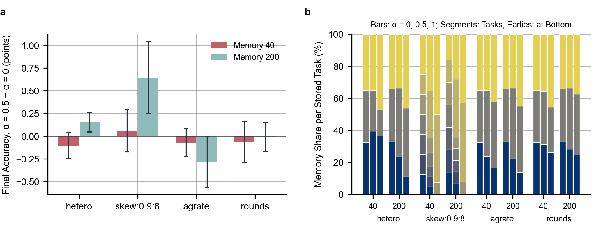
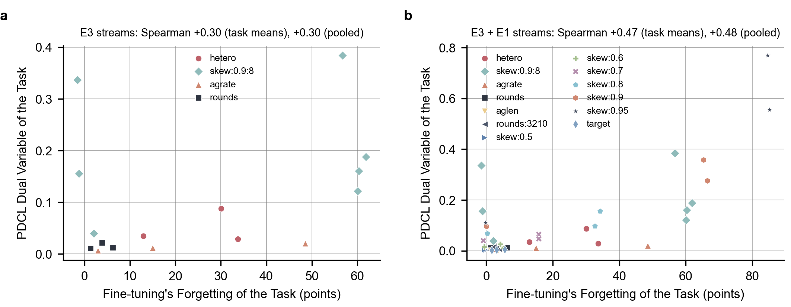

# E3. Allocation and the dual readout

Design: `findings.md`, section 0 (pre-registered; followed without change). Everything
marked *exploratory* was added after seeing numbers.

## Summary

1. **Allocation (pre-registered outcome: final accuracy, alpha 0.5 − alpha 0): null in all
   eight cells.** The largest difference is +0.64 ± 0.40 points (`skew:0.9:8`, memory 200,
   1.6 SE). The prediction "weak or null at memory 200" held. The prediction "possibly
   positive at memory 40 on `hetero` and `skew:0.9:8`" did not: −0.10 ± 0.14 and
   +0.06 ± 0.23.
2. **The null is not "allocation never moved".** At alpha 0.5, 7–34% of the memory sits
   in a different task than under the uniform split. Moving that much does not change
   final accuracy.
3. **Moving all of it (alpha 1) does matter, in both directions.** It helps on
   `skew:0.9:8` (+0.27 ± 0.12 at memory 40, +1.24 ± 0.52 at 200) and hurts on `agrate`
   (−0.45 ± 0.21 at 40, −1.82 ± 0.32 at 200). On `agrate` the rule takes memory away from
   task 0, the task fine-tuning forgets most, and task 0 loses 7.2 ± 1.7 points.
4. **Dual readout (pre-registered: positive rank correlation with fine-tuning's
   forgetting): held, pooled.** Spearman +0.30 (bootstrap 95% [+0.25, +0.34]) on the four
   E3 streams, +0.48 [+0.44, +0.51] on the thirteen E3 + E1 streams. The correlation is
   carried by differences between streams (stream means: +0.84 over 13 streams). Within
   a stream it is weak: mean within-stream correlation +0.23 [+0.14, +0.31], and close
   to zero on three of the four E3 streams.
5. **On `hetero` the duals do not single out the costly tasks.** Task 0 (binder rate 0.72,
   fine-tuning forgets 33.7 points) has the same dual as task 1 (0.52, forgets 13.0):
   0.029 vs 0.034, difference −0.005 ± 0.010. Task 2 is singled out (0.088,
   +0.053 ± 0.009 over task 1), but so is every most-recent task: the dual follows
   recency more than cost.

So on this data the dual variables say which *stream* is costly to retain, not which
*task* inside a stream, and a memory split that follows them gains nothing at the default
setting and can lose when pushed.

## Runs

400 runs, all finished: streams `hetero`, `skew:0.9:8`, `agrate`, `rounds`; whole stream,
1,000 steps per task, checkpoints every 250 steps, seeds 0–9. `PDCL_RS` with alpha 0,
0.5, 1 and `ER`, each with memory 40 and 200; `Finetune` and `ERM` once per stream.
Code hash `6766f6a0952f` (the same as the E1 runs used below). GPU 6.

- Spec: `results/e3_sweeps.json`
- Per-run table: `results/e3_runs.csv` (group = `<stream>_m<memory>` or `<stream>_ref`)
- All tables, generated: `results/e3_tables.md`
- Readout points: `results/e3_readout_points.csv`, `results/e3_dual_lastphase.csv`
- Script: `python -m domainbed.scripts.e3_analysis [--collect]`
- Figures: `paper/figures/fig_e3_allocation.{pdf,png}`, `fig_e3_readout.{pdf,png}`

Numbers are percent, mean ± SE over ten seeds; differences are paired by seed; `*` marks
a difference larger than two standard errors (the pre-registered criterion). Runs of one
seed share the data split, the initial weights and the minibatch stream; the draws from
the memory are not shared between variants.

## 1. Allocation

### Final accuracy and forgetting

| Stream | Memory | Joint ERM | Fine-tuning | ER | PDCL α 0 | PDCL α 0.5 | PDCL α 1 |
|---|---|---|---|---|---|---|---|
| `hetero` | 40 | 70.01 ± 0.17 | 57.55 ± 0.55 | 60.55 ± 0.66 | 58.46 ± 0.48 | 58.35 ± 0.56 | 58.09 ± 0.51 |
| `hetero` | 200 | | | 63.30 ± 0.40 | 60.33 ± 0.56 | 60.48 ± 0.50 | 60.79 ± 0.67 |
| `skew:0.9:8` | 40 | 68.85 ± 0.19 | 58.65 ± 0.33 | 59.98 ± 0.39 | 59.23 ± 0.24 | 59.29 ± 0.25 | 59.50 ± 0.25 |
| `skew:0.9:8` | 200 | | | 62.76 ± 0.34 | 61.40 ± 0.33 | 62.05 ± 0.29 | 62.64 ± 0.42 |
| `agrate` | 40 | 69.89 ± 0.23 | 54.05 ± 0.23 | 61.25 ± 0.57 | 55.85 ± 0.33 | 55.78 ± 0.28 | 55.41 ± 0.31 |
| `agrate` | 200 | | | 64.46 ± 0.31 | 60.16 ± 0.41 | 59.88 ± 0.48 | 58.34 ± 0.48 |
| `rounds` | 40 | 70.10 ± 0.28 | 66.54 ± 0.56 | 66.63 ± 0.44 | 66.91 ± 0.53 | 66.84 ± 0.55 | 66.72 ± 0.45 |
| `rounds` | 200 | | | 66.59 ± 0.47 | 66.97 ± 0.45 | 66.96 ± 0.55 | 66.86 ± 0.50 |

Forgetting (same layout):

| Stream | Memory | Fine-tuning | ER | PDCL α 0 | PDCL α 0.5 | PDCL α 1 |
|---|---|---|---|---|---|---|
| `hetero` | 40 | 25.59 ± 0.79 | 19.39 ± 0.88 | 24.04 ± 0.72 | 24.08 ± 0.79 | 24.41 ± 0.79 |
| `hetero` | 200 | | 14.19 ± 0.69 | 21.41 ± 0.75 | 21.17 ± 0.74 | 20.72 ± 0.79 |
| `skew:0.9:8` | 40 | 34.05 ± 0.48 | 26.30 ± 0.49 | 32.09 ± 0.43 | 31.87 ± 0.28 | 30.91 ± 0.40 |
| `skew:0.9:8` | 200 | | 17.73 ± 0.36 | 25.12 ± 0.34 | 24.29 ± 0.33 | 21.33 ± 0.66 |
| `agrate` | 40 | 22.15 ± 0.62 | 11.95 ± 0.77 | 19.81 ± 0.81 | 19.96 ± 0.67 | 20.60 ± 0.69 |
| `agrate` | 200 | | 6.87 ± 0.50 | 14.00 ± 0.83 | 14.46 ± 0.91 | 16.31 ± 0.89 |
| `rounds` | 40 | 3.80 ± 0.67 | 2.48 ± 0.36 | 3.04 ± 0.60 | 3.10 ± 0.60 | 3.42 ± 0.54 |
| `rounds` | 200 | | 2.66 ± 0.43 | 3.00 ± 0.56 | 3.11 ± 0.65 | 3.20 ± 0.55 |

### Paired differences against uniform memory (alpha 0)

Early tasks = first half of the stream (tasks 0–1 of four, 0–3 of eight).

| Stream | Memory | Difference | Final accuracy | Forgetting | Accuracy task 0 | Accuracy early tasks |
|---|---|---|---|---|---|---|
| `hetero` | 40 | 0.5 − 0 | −0.10 ± 0.14 | +0.04 ± 0.18 | −0.17 ± 0.18 | −0.02 ± 0.16 |
| `hetero` | 40 | 1 − 0 | −0.37 ± 0.19 | +0.37 ± 0.28 | −0.74 ± 0.35 * | −0.51 ± 0.26 |
| `hetero` | 200 | 0.5 − 0 | +0.15 ± 0.11 | −0.24 ± 0.19 | −0.04 ± 0.26 | +0.12 ± 0.16 |
| `hetero` | 200 | 1 − 0 | +0.46 ± 0.28 | −0.68 ± 0.31 * | +0.80 ± 0.52 | +0.51 ± 0.41 |
| `skew:0.9:8` | 40 | 0.5 − 0 | +0.06 ± 0.23 | −0.22 ± 0.34 | −0.00 ± 0.72 | +0.45 ± 0.24 |
| `skew:0.9:8` | 40 | 1 − 0 | +0.27 ± 0.12 * | −1.18 ± 0.28 * | +1.56 ± 0.63 * | +0.31 ± 0.27 |
| `skew:0.9:8` | 200 | 0.5 − 0 | +0.64 ± 0.40 | −0.83 ± 0.44 | +1.56 ± 0.93 | +0.80 ± 0.46 |
| `skew:0.9:8` | 200 | 1 − 0 | +1.24 ± 0.52 * | −3.79 ± 0.81 * | +4.95 ± 0.61 * | +1.48 ± 0.48 * |
| `agrate` | 40 | 0.5 − 0 | −0.07 ± 0.15 | +0.15 ± 0.22 | −1.02 ± 0.44 * | −0.45 ± 0.28 |
| `agrate` | 40 | 1 − 0 | −0.45 ± 0.21 * | +0.80 ± 0.37 * | −2.25 ± 1.00 * | −1.08 ± 0.51 * |
| `agrate` | 200 | 0.5 − 0 | −0.28 ± 0.28 | +0.46 ± 0.41 | −1.83 ± 1.01 | −0.65 ± 0.53 |
| `agrate` | 200 | 1 − 0 | −1.82 ± 0.32 * | +2.31 ± 0.43 * | −7.15 ± 1.68 * | −3.52 ± 0.72 * |
| `rounds` | 40 | 0.5 − 0 | −0.07 ± 0.23 | +0.06 ± 0.25 | +0.04 ± 0.56 | −0.06 ± 0.33 |
| `rounds` | 40 | 1 − 0 | −0.19 ± 0.17 | +0.39 ± 0.20 | −0.31 ± 0.33 | −0.34 ± 0.24 |
| `rounds` | 200 | 0.5 − 0 | −0.01 ± 0.16 | +0.12 ± 0.27 | +0.73 ± 0.46 | +0.27 ± 0.29 |
| `rounds` | 200 | 1 − 0 | −0.12 ± 0.13 | +0.20 ± 0.24 | −0.19 ± 0.54 | −0.12 ± 0.34 |

**Pre-registered outcome (0.5 − 0, final accuracy).** Null in 8 of 8 cells. No cell
reaches two standard errors on final accuracy or on forgetting. The one starred entry in
the 0.5 − 0 rows is a *loss* on task 0 of `agrate` at memory 40 (−1.02 ± 0.44).

| Prediction | Result |
|---|---|
| Weak or null at memory 200 | **Held**: −0.28 to +0.64, none above 2 SE |
| Possibly positive at memory 40 on `hetero` | **Null**: −0.10 ± 0.14 |
| Possibly positive at memory 40 on `skew:0.9:8` | **Null**: +0.06 ± 0.23 |

A smaller memory does not make allocation matter more; if anything the effects of
alpha 1 are larger at memory 200, where there are more examples to move.

### How the memory was divided

Share of the stored examples per earlier task at the last step (the last task is never
stored), mean over seeds. *Moved* = share of the memory that sits in a different task
than under alpha 0 in the same seed.

| Stream | Memory | α 0 | α 0.5 | α 1 | Moved, α 0.5 | Moved, α 1 |
|---|---|---|---|---|---|---|
| `hetero` | 40 | 33 / 33 / 35 | 40 / 26 / 35 | 36 / 16 / 47 | 14% | 26% |
| `hetero` | 200 | 33 / 33 / 34 | 24 / 43 / 34 | 11 / 43 / 46 | 14% | 28% |
| `skew:0.9:8` | 40 | 12 ×6 / 25 | 5 / 6 / 6 / 9 / 10 / 29 / 35 | 0 / 0 / 0 / 0 / 8 / 43 / 50 | 32% | 62% |
| `skew:0.9:8` | 200 | 14 ×6 / 16 | 7 / 7 / 7 / 7 / 7 / 36 / 28 | 0 / 0 / 0 / 0 / 8 / 49 / 43 | 34% | 64% |
| `agrate` | 40 | 33 / 33 / 35 | 24 / 41 / 35 | 16 / 41 / 42 | 9% | 16% |
| `agrate` | 200 | 33 / 33 / 34 | 22 / 44 / 34 | 14 / 42 / 45 | 14% | 28% |
| `rounds` | 40 | 33 / 33 / 35 | 31 / 33 / 36 | 26 / 28 / 45 | 15% | 28% |
| `rounds` | 200 | 33 / 33 / 34 | 28 / 38 / 34 | 25 / 38 / 37 | 7% | 15% |

So the shares move. The reason for the null at alpha 0.5 is that **moving them does not
matter at that size**, not that they stay put.

**Where the memory goes.** It goes to the recent tasks, not to the costly ones:

- `hetero`, memory 200: task 0 is the task fine-tuning forgets most (33.7 points) and its
  share falls from 33% to 24% (alpha 0.5) and 11% (alpha 1). The shares are fixed when
  task 2 ends, from the duals built up *while training on task 2*, which has the same
  binder rate as task 0, so task 0's constraint was not under pressure then. The cost
  arrives in the last phase (binder rate 0.11), after the last refill.
- `agrate`: task 0 is forgotten most (48.5 points with fine-tuning) and its share falls to
  22% and 14%. With alpha 1 at memory 200 its accuracy drops 7.15 ± 1.68 points and final
  accuracy 1.82 ± 0.32.
- `skew:0.9:8`: alpha 1 empties the memory of tasks 0–3 and puts 92% into tasks 5 and 6.
  Accuracy on task 0 *rises* by 4.95 ± 0.61 at memory 200, and on every even task by
  3.4–5.0, while every odd task loses 1.2–1.8. In this stream the even tasks are
  interchangeable (same binder rate, random halves of the same data), so examples of
  task 6 serve task 0 as well as its own would. The gain is from holding more binder-rich
  examples, not from protecting particular tasks.

Two properties of the rule as implemented (`train_batched.py`, `end_of_domain` and
`partition_sizes`), read from the code, explain the pattern. A task's stored set can only
shrink at a refill, never grow back, so memory lost early is gone. And on a four-task
stream the split can differ from uniform only at the last refill (at the first there is
one task; at the second the new task is given the mean dual, which makes the two shares
equal), so all of the alpha effect on those streams comes from one decision made before
the last phase.

**Reference, not the question of E3:** uniform ER (weight 1) is above default PDCL on
`hetero` (+2.19 ± 0.44 at memory 40, +2.82 ± 0.40 at 200) and `agrate` (+5.46 ± 0.55,
+4.58 ± 0.46), not separable on `skew:0.9:8` (+0.69 ± 0.37, +0.72 ± 0.41) and `rounds`.
PDCL is above fine-tuning on the three streams that forget (+0.6 to +5.8) and not on
`rounds` (+0.30 ± 0.17, +0.42 ± 0.22). On `hetero` and `agrate` the gap between ER and PDCL
is larger than any effect of alpha on the same stream.

## 2. Dual readout

x = PDCL's dual variable of an earlier task (`dual_mean_k`: mean over the checkpoints
after the task's phase; default alpha, memory 200); y = fine-tuning's forgetting of the
same task in the same seed (`forget_k`). One point per stream, seed and earlier task.

**E1 streams used (read-only):** `aglen`, `target`, `rounds:3210`, `skew:0.5`, `0.6`,
`0.7`, `0.8`, `0.9`, `0.95`, from `results/e1_runs.csv` in the sibling worktree
`pdcl-e1-retention-dial-6f00e4` as it stood on 2026-11-21 (1,000 steps per task, seeds
0–9, methods `PDCL_RS` and `Finetune`; same code hash). `rounds` and `agrate` are taken
from the E3 runs. If E1 changes that table, rerun `e3_analysis`.

### Spearman rank correlations

95% interval from a bootstrap over the ten seeds (the same resampled seeds in every
stream).

| Streams | Level | Points | Spearman | Bootstrap 95% |
|---|---|---|---|---|
| E3 (4) | pooled over seeds, tasks, streams | 160 | +0.30 | [+0.25, +0.34] |
| E3 (4) | task means | 16 | +0.30 | [+0.23, +0.34] |
| E3 (4) | stream means | 4 | +0.80 | (four points) |
| E3 (4) | mean of within-stream correlations | 4 | +0.17 | [+0.05, +0.28] |
| E3 + E1 (13) | pooled over seeds, tasks, streams | 430 | **+0.48** | [+0.44, +0.51] |
| E3 + E1 (13) | task means | 43 | +0.47 | [+0.40, +0.52] |
| E3 + E1 (13) | stream means | 13 | **+0.84** | [+0.74, +0.93] |
| E3 + E1 (13) | mean of within-stream correlations | 13 | +0.23 | [+0.14, +0.31] |

**Pre-registered prediction (positive): held** for the pooled value, with an interval
well away from zero. The bootstrap resamples seeds only; it does not cover the choice of
streams, and six of the thirteen are one family (`skew:Q`).

Within each stream (30 points each, 70 for the eight-task stream):

| Stream | From | Spearman | Mean dual | Mean FT forgetting |
|---|---|---|---|---|
| `skew:0.5` | E1 | −0.00 | 0.004 | −0.30 |
| `aglen` | E1 | +0.20 | 0.002 | 3.18 |
| `target` | E1 | +0.14 | 0.003 | 3.44 |
| `rounds:3210` | E1 | −0.03 | 0.013 | 3.21 |
| `rounds` | E3 | −0.08 | 0.015 | 3.80 |
| `skew:0.6` | E1 | −0.19 | 0.017 | 2.87 |
| `skew:0.7` | E1 | +0.33 | 0.051 | 10.16 |
| `agrate` | E3 | +0.74 | 0.013 | 22.15 |
| `skew:0.8` | E1 | +0.65 | 0.107 | 22.38 |
| `hetero` | E3 | +0.02 | 0.050 | 25.59 |
| `skew:0.9:8` | E3 | −0.01 | 0.198 | 34.05 |
| `skew:0.9` | E1 | +0.58 | 0.243 | 43.97 |
| `skew:0.95` | E1 | +0.63 | 0.479 | 56.51 |

The dual is a good readout **across streams**: it is near zero where fine-tuning forgets
3 points and grows to 0.5 where it forgets 57. It is a poor readout **across the tasks
of one stream**: clearly positive on `agrate` and on `skew:Q` for Q ≥ 0.7, zero on
`hetero`, `skew:0.9:8`, `rounds` and the other low-forgetting streams. `agrate` is an
exception to the stream-level relation as well: fine-tuning forgets 22 points and the
mean dual is 0.013, as low as on `rounds`.

### `hetero`: tasks 0 and 2 (binder rate 0.72) against task 1 (0.52)

| Task | Binder rate | Dual (mean after phase) | Dual (last step) | FT forgetting | PDCL forgetting |
|---|---|---|---|---|---|
| 0 | 0.72 | 0.029 ± 0.006 | 0.020 ± 0.005 | 33.70 ± 1.33 | 29.02 ± 1.32 |
| 1 | 0.52 | 0.034 ± 0.005 | 0.029 ± 0.006 | 12.96 ± 0.72 | 9.26 ± 0.60 |
| 2 | 0.72 | 0.088 ± 0.006 | 0.036 ± 0.004 | 30.09 ± 1.09 | 25.22 ± 1.20 |

| Paired over seeds | Task 0 − task 1 | Task 2 − task 1 |
|---|---|---|
| Dual, mean after phase | −0.005 ± 0.010 (2 of 10 seeds positive) | +0.053 ± 0.009 * (10 of 10) |
| Dual, last step | −0.009 ± 0.009 | +0.007 ± 0.006 |
| Fine-tuning's forgetting | +20.7 ± 1.5 * | +17.1 ± 1.1 * |

**The duals single out task 2 and not task 0.** Fine-tuning's forgetting separates both
costly tasks from task 1 by 17–21 points in every seed; the dual separates only the most
recent one. The eight-task stream shows the same recency ordering: duals of tasks 0–6 are
0.16, 0.04, 0.12, 0.16, 0.19, 0.34, 0.38, while fine-tuning's forgetting alternates
60 / 2 / 60 / −1 / 62 / −1 / 57. Tasks 3 and 5 carry large duals although the stream
ends on a task like them and fine-tuning does not forget them at the end: the dual
integrates violations along the whole path, forgetting is read at the end.

### Exploratory (not pre-registered): dual over the last phase only

To remove that mismatch of time windows, the dual was averaged over the checkpoints of
the last phase only (`results/e3_dual_lastphase.csv`, from the raw run records).

| Streams | Level | Pre-registered dual | Last-phase dual | Bootstrap 95% (last-phase) |
|---|---|---|---|---|
| E3 | pooled | +0.30 | +0.29 | [+0.24, +0.34] |
| E3 | mean within stream | +0.17 | +0.02 | [−0.12, +0.16] |
| E3 + E1 | pooled | +0.48 | +0.59 | [+0.57, +0.61] |
| E3 + E1 | task means | +0.47 | +0.64 | [+0.59, +0.69] |
| E3 + E1 | mean within stream | +0.23 | +0.21 | [+0.15, +0.27] |

The pooled correlation rises on the thirteen streams; the within-stream one does not,
and `hetero` is unchanged (last-phase duals 0.037 / 0.045 / 0.088; task 0 − task 1
−0.007 ± 0.017). The window is not the reason task 0 goes unflagged. A candidate reason,
not tested here: the dual responds to the loss on the *stored* examples of a task, which
the paper showed can stay low while validation accuracy on the task falls, and the
oldest task's stored examples have been replayed the longest.

## What this says about claims 2 and 3 of section 0

- **Claim 2 (the dual is a readout of retention cost):** true between streams, weak
  between tasks. Usable to tell whether a stream needs replay at all; not usable, on this
  data, to tell which task needs it.
- **Claim 3 (memory should follow the duals):** not supported. At the published setting
  it changes nothing although a seventh to a third of the memory moves; pushed to alpha 1
  it helps only where tasks are interchangeable and hurts where the oldest task is the
  costly one, because the duals it follows favour recent tasks.

## Limits

- One model, one learning rate, 1,000 steps per task, ten seeds. Effects below about
  0.2–0.8 points (two standard errors, depending on the cell) cannot be seen.
- Four tasks give the rule one decision per run; `skew:0.9:8` is the only stream where
  allocation acts repeatedly, and it is a controlled stream.
- `hetero`, `skew` and `agrate` are constructed streams; `rounds` is the only natural one
  here and shows nothing, as expected.
- The mechanism statements (recency, interchangeable tasks) are read off the tables and
  the code; no run isolates them.
