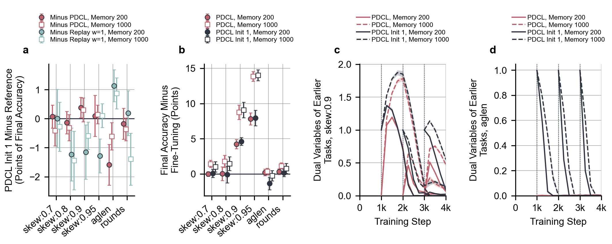

# H3. Dual variables that start at 1

Pre-registered in `findings.md` section 0c and followed without change. 420 runs, all
finished, made with `train_batched.py` from `results/h3_sweeps.json`. Every number below
is recomputed from the raw runs by `python -m domainbed.scripts.h3_analysis`
(`results/h3_runs.csv`, `results/h3_tables.md`, `paper/figures/fig_h3_init.{pdf,png}`).

- Trainer: new hparam `dual_init` (absent or 0 = the published method). When a task
  becomes an earlier task, its dual variable is set to `dual_init`. Nothing else changes.
- Streams `skew:0.7`, `0.8`, `0.9`, `0.95`, `aglen`, `rounds`; memory 200 and 1,000;
  PDCL with `dual_init` 1, default PDCL, ER with weight 1, fine-tuning; 4,000 steps
  (1,000 per task); seeds 0–9; final accuracy at the last step.
- "a ± b" is mean ± standard error over the 10 seeds, paired by seed. A difference is
  called real only above two standard errors (bold).

## Answer

**No. Starting the dual variables at 1 does not close the gap to replay, and it gives up
PDCL's safety on `aglen`.**

- On the skewed streams with a gap at memory 200, init 1 closes −13% (`skew:0.8`), 25%
  (`skew:0.9`) and 7% (`skew:0.95`) of the gap between default PDCL and ER w=1. Only the
  `skew:0.9` gain over default PDCL is real (+0.38 ± 0.17). Init 1 stays 1.2 to 1.3
  points below ER w=1 on all three.
- On `aglen` with memory 200, init 1 is 1.37 ± 0.43 below fine-tuning and 1.59 ± 0.35
  below default PDCL. Default PDCL is at fine-tuning there (+0.22 ± 0.24). With memory
  1,000 init 1 is at fine-tuning (−0.25 ± 0.36) but still 0.61 ± 0.23 below default PDCL.
- Why: where the constraint binds (`skew:0.9`), default PDCL's dual variable passes 1
  within 250 steps on its own, so the head start is gone by step 2,000 (0.73 against
  0.71). Where it does not bind (`aglen`), the dual variable takes 500 steps (memory
  200) to 1,000 steps (memory 1,000) to fall to 0, and that much replay at weight near
  1 is enough to cost accuracy.

For context only, from F1 (other runs, `results/f1_runs.csv`): the oracle that measures
constraints on validation data closed 86%, 102% and 140% of the same gap at memory 200
and stayed at fine-tuning on `aglen` (+0.37 ± 0.31). The initial value is not a
substitute for an honest measurement of the constraint.

## Pre-registered predictions

| Cell | Prediction | Measured | Outcome |
|---|---|---|---|
| aglen, memory 200 | within 2 SE of fine-tuning | **−1.37 ± 0.43** | failed |
| aglen, memory 1000 | within 2 SE of fine-tuning | −0.25 ± 0.36 | held |
| rounds, memory 200 | within 2 SE of fine-tuning | +0.15 ± 0.27 | held |
| rounds, memory 1000 | within 2 SE of fine-tuning | **+0.78 ± 0.35** | failed (above) |
| skew:0.9, memory 200 | closes less than half of ER w=1 − PDCL | +0.38 of +1.54 (25%) | held |
| skew:0.9, memory 1000 | closes less than half of ER w=1 − PDCL | +0.30 of +0.89 (34%) | held |
| skew:0.95, memory 200 | closes less than half of ER w=1 − PDCL | +0.10 of +1.38 (7%) | held |
| skew:0.95, memory 1000 | closes less than half of ER w=1 − PDCL | gap +0.04 ± 0.20 | not testable (no gap) |

The "falls quickly, so safe" half of the prediction failed in the one cell that matters
(`aglen`, memory 200): the fall is not quick enough. The `rounds`, memory 1,000 failure is
in the harmless direction; default PDCL is also above fine-tuning there (+1.15 ± 0.21)
and init 1 is not above default PDCL (−0.37 ± 0.20).

## Table

Final accuracy (%), then paired differences in points.

| Memory 200 | skew:0.7 | skew:0.8 | skew:0.9 | skew:0.95 | aglen | rounds |
|---|---|---|---|---|---|---|
| Fine-tuning | 66.38 ± 0.34 | 64.27 ± 0.50 | 57.42 ± 0.51 | 52.57 ± 0.32 | 68.00 ± 0.44 | 66.54 ± 0.56 |
| ER w=1 | 66.44 ± 0.33 | 65.41 ± 0.32 | 63.18 ± 0.32 | 61.79 ± 0.55 | 65.50 ± 0.48 | 66.50 ± 0.64 |
| PDCL | 66.37 ± 0.34 | 64.32 ± 0.62 | 61.65 ± 0.54 | 60.40 ± 0.42 | 68.22 ± 0.34 | 66.86 ± 0.56 |
| PDCL init 1 | 66.45 ± 0.30 | 64.18 ± 0.66 | 62.03 ± 0.61 | 60.50 ± 0.60 | 66.63 ± 0.53 | 66.69 ± 0.48 |
| init 1 − PDCL | +0.07 ± 0.20 | −0.14 ± 0.19 | **+0.38 ± 0.17** | +0.10 ± 0.35 | **−1.59 ± 0.35** | −0.17 ± 0.27 |
| init 1 − ER w=1 | +0.01 ± 0.50 | **−1.23 ± 0.46** | **−1.15 ± 0.47** | **−1.28 ± 0.29** | **+1.13 ± 0.27** | +0.19 ± 0.38 |
| init 1 − fine-tuning | +0.06 ± 0.28 | −0.09 ± 0.59 | **+4.61 ± 0.28** | **+7.93 ± 0.55** | **−1.37 ± 0.43** | +0.15 ± 0.27 |
| ER w=1 − PDCL (gap) | +0.07 ± 0.53 | **+1.09 ± 0.46** | **+1.54 ± 0.44** | **+1.38 ± 0.30** | **−2.72 ± 0.37** | −0.37 ± 0.35 |
| share of gap closed | no gap | −13% | 25% | 7% | no gap | no gap |
| F1 oracle − PDCL (other runs) | −0.26 ± 0.52 | +1.04 ± 0.53 | **+1.27 ± 0.44** | **+2.35 ± 0.42** | +0.24 ± 0.24 | −0.59 ± 0.55 |
| F1 share closed by oracle | no gap | 86% | 102% | 140% | no gap | no gap |

| Memory 1000 | skew:0.7 | skew:0.8 | skew:0.9 | skew:0.95 | aglen | rounds |
|---|---|---|---|---|---|---|
| ER w=1 | 67.69 ± 0.41 | 67.19 ± 0.16 | 67.08 ± 0.27 | 66.47 ± 0.31 | 66.88 ± 0.34 | 68.72 ± 0.37 |
| PDCL | 67.82 ± 0.37 | 66.06 ± 0.45 | 66.19 ± 0.39 | 66.43 ± 0.32 | 68.36 ± 0.37 | 67.69 ± 0.41 |
| PDCL init 1 | 67.41 ± 0.38 | 65.75 ± 0.58 | 66.50 ± 0.42 | 66.57 ± 0.33 | 67.75 ± 0.28 | 67.33 ± 0.43 |
| init 1 − PDCL | −0.41 ± 0.26 | −0.31 ± 0.22 | +0.30 ± 0.20 | +0.15 ± 0.16 | **−0.61 ± 0.23** | −0.37 ± 0.20 |
| init 1 − ER w=1 | −0.28 ± 0.42 | **−1.44 ± 0.50** | **−0.59 ± 0.23** | +0.11 ± 0.21 | **+0.88 ± 0.27** | **−1.39 ± 0.45** |
| init 1 − fine-tuning | **+1.03 ± 0.37** | **+1.47 ± 0.49** | **+9.08 ± 0.54** | **+14.00 ± 0.39** | −0.25 ± 0.36 | **+0.78 ± 0.35** |
| ER w=1 − PDCL (gap) | −0.13 ± 0.40 | **+1.13 ± 0.38** | **+0.89 ± 0.22** | +0.04 ± 0.20 | **−1.48 ± 0.28** | **+1.03 ± 0.43** |
| share of gap closed | no gap | −27% | 34% | no gap | no gap | −35% |
| F1 oracle − PDCL (other runs) | +0.15 ± 0.40 | **+1.18 ± 0.45** | +0.50 ± 0.31 | −0.26 ± 0.21 | −0.01 ± 0.28 | +0.34 ± 0.44 |

With memory 1,000 init 1 is never above default PDCL beyond two standard errors and is
below it on `aglen`.

Dual variable of the first task (mean over seeds; it is created after step 999):

| Run | step 1000 | 1250 | 1500 | 2000 | 3000 | 3999 |
|---|---|---|---|---|---|---|
| skew:0.9, memory 200, PDCL | 0.00 | 1.08 | 1.19 | 0.73 | 0.00 | 0.02 |
| skew:0.9, memory 200, init 1 | 1.00 | 1.37 | 1.30 | 0.71 | 0.00 | 0.02 |
| skew:0.9, memory 1000, PDCL | 0.00 | 1.18 | 1.56 | 1.78 | 0.12 | 0.11 |
| skew:0.9, memory 1000, init 1 | 1.00 | 1.53 | 1.78 | 1.85 | 0.15 | 0.14 |
| aglen, memory 200, PDCL | 0.00 | 0.00 | 0.00 | 0.00 | 0.00 | 0.00 |
| aglen, memory 200, init 1 | 1.00 | 0.58 | 0.03 | 0.00 | 0.00 | 0.00 |
| aglen, memory 1000, PDCL | 0.00 | 0.00 | 0.00 | 0.00 | 0.00 | 0.00 |
| aglen, memory 1000, init 1 | 1.00 | 0.78 | 0.49 | 0.00 | 0.00 | 0.00 |

a, init 1 minus default PDCL and minus ER w=1. b, default PDCL and init 1 minus
fine-tuning. c, d, dual variables of the three earlier tasks on `skew:0.9` and `aglen`.
Bars in a, b are two standard errors; bands in c, d are one.

## Limits

- One initial value (1), one dual step size (0.01), 1,000 steps per task. A smaller
  step size would make the initial value last longer, for better on the skewed streams
  and for worse on `aglen`; not tested.
- The gap is against ER w=1, as pre-registered, not against the best of F1's four weights.
- The reruns of ER and default PDCL differ from the same configuration and seeds in F1
  by up to 0.55 points (4 of 24 cells above two standard errors, table T9 in
  `results/h3_tables.md`; fine-tuning is identical). The replay draws depend on which runs
  are trained together in a batch, so these are different random draws, not the same
  run repeated. All H3 comparisons are within H3; F1 numbers are context only.
- 12 primary cells are tested without correction for multiple comparisons. The one small
  win (`skew:0.9`, memory 200, +0.38 ± 0.17) is just above two standard errors and
  should not be leaned on; the `aglen` loss at memory 200 is above four.
- `dual_init` exists only in `train_batched.py`, not in `domainbed/algorithms.py`.
